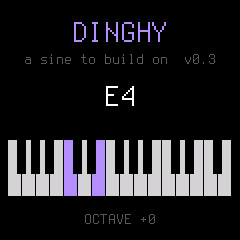

# MD-One

A **Mutable-derived drone machine** for the **M-VAVE FM-1** — a pocket
six-operator FM synthesizer built on a JieLi AC791N with the proprietary pi32v2
CPU. MD-One replaces its firmware with four Braids oscillators, tuned combs and
a modulation system, delivering into a DAW over USB audio.

*MD = Mutable Droner. The working directory is still `fm1-laboratory/`; the
instrument is MD-One.*

**It runs on hardware.** First flashed 2026-10-22 to the development unit; the
second unit stays boxed as a known-good reference. It boots, sounds, reports
**42% CPU (peak 45%)** on its own HOME page, and the rescue path has been
walked end to end on the device — see [docs/FIRMWARE_SAFETY.md](docs/FIRMWARE_SAFETY.md).

That line above about delivering into a DAW is the premise of the whole
instrument, and it was asserted for most of this project's life without ever
being tested. It is now measured: the FM-1 presents a **capture** endpoint,
and 2 s recorded from it reads **−3.2 dBFS peak, 99.6% non-zero, genuinely
stereo**, identically across MME, WASAPI and WDM-KS. The engine reaches a DAW
as digital audio with no analogue round trip.

Two things that cost real time and are worth knowing up front. The audio you
hear through a mixer may be the **analogue jack**, which proves nothing about
the USB path — they are separate, and ours was silent over USB for days while
sounding perfectly through the jack. And the capture stream can enter a state
where it streams digital zero until the device restarts; see
[docs/BUILD_AND_TEST.md](docs/BUILD_AND_TEST.md).

Host-side numbers in `docs/` come from the [fm1-emu](https://github.com/joakimeriksson/fm1-emu)
emulator, which is trustworthy for logic and **1.92× optimistic on timing** —
every timing claim is now checked against the device.

Licensing is **GPL-3.0-only**, inherited from Dinghy, with `dsp/` deliberately
MIT and free of GPL code so the engine stays reusable — see
[LICENSING.md](LICENSING.md).

## Status

| Layer | State |
| --- | --- |
| pi32v2 toolchain | **verified** — compiles and disassembles |
| Firmware build | **verified** — reproduces Dinghy 0.3 *byte for byte* |
| Emulator | **verified** — runs stock and our own builds, with audio and screen |
| Host DSP harness | **verified** — 5 tests pass, target rule check clean |
| Braids port | **verified** — all 48 shapes build for pi32v2, in tune at 44.1 kHz |
| Drone engine | **working** — 4 voices + combs + drift, 14.5% of the audio budget |
| Our firmware | not started — the engine runs on the host and in the emulator |
| Physical hardware | none |

The instrument we are building is a **drone machine using Mutable Instruments'
Braids engines**: several always-on voices with detune and slow spectral
evolution, keys latching notes in and out. See `docs/BRAIDS_PORT.md`.

## The three layers

Each is independently testable and catches a different class of bug. Hardware,
when it arrives, becomes a fourth layer that confirms rather than discovers.

```
dsp/            the mathematics            < 1 s     no device, no firmware
dinghy host     the firmware's C natively  ~2 s      real app code, WAV + screens
fm1-emu         the whole device           ~4 s      CPU, audio ISR, SPI display
```

## Quick start

```powershell
# references + toolchain (once)
.\scripts\clone-references.ps1
.\scripts\fix-line-endings.ps1 -Force
wsl -d archlinux -- bash scripts/setup-wsl-toolchain.sh
wsl -d archlinux -- bash scripts/verify-toolchain.sh

# emulator
cd references\fm1-emu; cargo build --release -p fm1-emu -p fm1-live; cd ..\..

# build everything and RUN it -- the gate before any commit
wsl -d archlinux -- bash scripts/check-all.sh
```

`check-all.sh` builds the DSP tests, the chip-rule check, the host renderers,
the three target probes and the firmware, then **loads the firmware into the
emulator and asserts it boots and makes a sound**. Compiling is not verifying:
three consumers of the parameter table sat broken for days because nothing
built them together.

Exact commands and their real output: **`docs/BUILD_AND_TEST.md`**.

## Layout

**Start with [`docs/ROADMAP.md`](docs/ROADMAP.md)** for what the instrument is
and where it stands, and [`docs/UX_DESIGN.md`](docs/UX_DESIGN.md) for the
control surface. [`docs/BRAIDS_SHAPES.md`](docs/BRAIDS_SHAPES.md) is the
player's reference: what TIMBRE and COLOR do on each of the 48 oscillators,
derived from the vendored renderers.

```
docs/          roadmap, UX design, environment, repo map, hardware,
               build+test, safety, licences, platform survey, Braids port,
               shape reference, MIDI spec, drone engine, open questions
references/    upstream clones, read-only, pinned (gitignored)
firmware/      our firmware -- empty, deliberately
dsp/           shared/ (integer, ships) + host/ (float reference) + target/ + tests/
scripts/       setup, verification, fetch, run, analysis
artifacts/     builds, downloads, rendered audio, screenshots (gitignored)
tools/         empty -- toolchains live outside the tree, see tools/README.md
```

## What the bootstrap established

**The toolchain is real.** JieLi's clang 4.0.1 with the `pi32v2` backend
compiles C to `ELF32-pi32v2` (`e_machine 0xf1`) and the vendor objdump
disassembles it. The ISA is Blackfin-style algebraic assembly with
scaled-index addressing and multi-register push/pop.

**The build pipeline is exact.** Our Dinghy 0.3 build matches the author's
published release byte for byte:

```
4e907044a7bda340317fc910d33a0e006eb4d587e08d8980de74d7edcca3ca8e
```

Compiler, SDK revision, flags and packaging all match. This is the strongest
validation available without hardware.

**The emulator closes the loop.** Holding note keys 7 and 11 produced 261.5 Hz
and 329.1 Hz — C4 and E4, a major third, matching the 4-semitone spacing — and
the rendered panel agrees:



Our *own* build runs there too, so edit → build → emulate → listen works today.

**The DSP harness respects the real chip.** No float, no 64-bit division,
enforced by compiling `dsp/shared/` with the actual target compiler. Tuning
holds to 0.0009 cents; fixed point tracks a double reference at 84.5 dB.

## Two decisions already forced

**1. Licence.** Dinghy is **GPL-3.0-only**, so our firmware will be too, and
everyone we hand a build to is entitled to the complete source. If the engine
must ever be proprietary, that has to be decided *now* — the alternative is
writing the USB stack, update path, rescue mode and HAL from scratch.
`docs/LICENSE_REGISTER.md`.

`dsp/` is kept MIT and free of GPL code so the synthesis engine stays reusable.

**2. No flashing.** Single flash bank, no recovery button, no test pads, no
debug header, and updates authenticated by CRC-16 with no signature. One SysEx
byte separates "upgrade" from "mask-ROM download mode". The gate that must be
satisfied before any physical write is in `docs/FIRMWARE_SAFETY.md`.

## The Braids vertical slice

`docs/BRAIDS_PORT.md` has the detail. The three results that matter:

* **Braids is the one MI module that fits.** It was written for a 72 MHz
  STM32F1 with no FPU and contains **zero** `float` tokens in 8,019 lines.
  Plaits, Rings, Elements and Clouds assume an FPU and would need full
  fixed-point rewrites.
* **It compiles for pi32v2** — 48 shapes, ~97 KB, no soft-float, no 64-bit
  division — and renders **in tune at 44.1 kHz** via a constant pitch offset
  of 13.47 semitones, with no regenerated tables. Measured: MIDI 36/48/60 →
  65.1 / 131.1 / 261.5 Hz.
* **CPU is not a constraint either.** Measured on the emulated pi32v2, one
  voice costs **1.1%–3.2%** of the 256-frame audio budget depending on shape
  (15,129–45,139 cycles of 1,393,152). Four voices of the most expensive shape
  is **12.9%**.
* **Memory is not the constraint.** The device has **512 KiB** of RAM, of
  which Dinghy uses ~42 KiB, leaving ~390 KiB across `.bss` (84 KiB) and the
  `.pool` region for big buffers (306 KiB). Four `MacroOscillator` voices is
  68.6 KiB — and four voices is already twelve oscillators, since the
  `TRIPLE_*` shapes are three detuned oscillators each.

## Why Dinghy, checked rather than assumed

Dinghy came into this project as an outside suggestion, so it was surveyed
against nine other firmwares (`docs/PLATFORM_SURVEY.md`):

* **No shipped firmware uses Dinghy as a base** — of 49 catalogued firmwares,
  20 declare a lineage: Felucca 10, SLOOP 7, X0X 2, Dinghy **0**.
* But there is only **one** FM-1 platform. 9 of 10 repos share the identical
  layout, and all 17 of Dinghy's HAL files exist in every one of them.
* **Dinghy's HAL matches the ecosystem majority on all 17 files** — it is a
  minimal cut of the common platform, not a stale fork.
* Its `platform.c` *is* unique and three weeks old, which is the real risk.
  Mitigated: our build reproduces the release byte-for-byte, and obervave and
  zp12 (same author, shipped) are the fallback.
* Dinghy has **no MIDI CC parsing**, so the parameter layer will be modelled
  on obervave's `pdef_t` table instead of invented.

## Recommended first milestone

**A single harmonic-spectrum oscillator with a desktop reference renderer.**

Concretely: extend `scripts/gen_sine_table.py` to synthesise a wavetable from a
list of partial amplitudes, add `fm1_osc_table()` alongside the existing sine,
and render sine / saw / square from their harmonic series.

It is the right next step because:

* every later goal — the Operator-style spectrum editor, FM with non-sine
  operators, wavetable morphing — is this plus interpolation;
* it needs no new infrastructure: the generator, the Q15 oscillator, the WAV
  renderer, the SNR test and the target rule check all exist and pass;
* it is measurable. A band-limited saw from 32 partials can be checked against
  its analytic spectrum, so "is it right?" has a numeric answer;
* it will immediately produce the one number we are missing — what a table
  oscillator costs per voice — which feeds Q2 and Q7 in
  `docs/OPEN_QUESTIONS.md`.

**Not** a firmware rewrite. The firmware stays unmodified Dinghy until the
oscillator sounds right on the host.

## Open questions

Ten, in `docs/OPEN_QUESTIONS.md`. The two that could cost real time:

* **Q1** — the toolchain download is unpinned; archive `~/.jieli/` before
  depending on a build.
* **Q2** — we have no cycle-accurate target cost model, only host-relative
  timing. `fm1-emu`'s `--trace` and PC histogram may give one without hardware.
